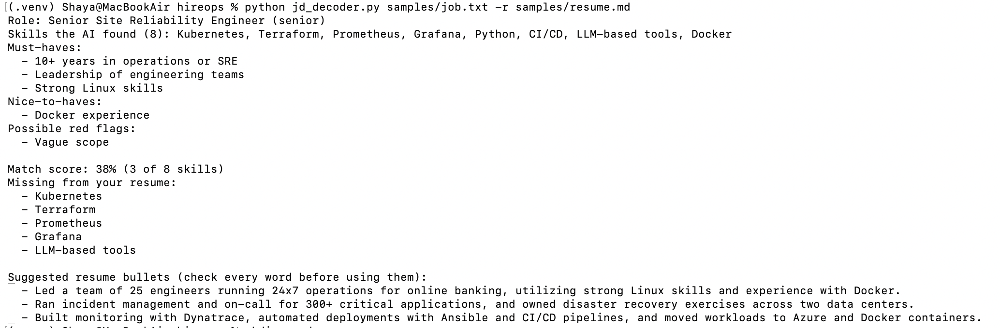

# HireOps

An SRE's toolkit for the job search: small, free, open-source tools that run on your own laptop. One new tool every week.

## Tool 1: JD Decoder (v0.1.0, prototype)

Give it a job description and your resume. It tells you:

- What the job really asks for: every skill it mentions (found by a local AI model, with no fixed keyword list), must-haves, nice-to-haves, seniority, years of experience, and red flags, each with the exact words from the posting that raise it
- Your match score: the share of the job's skills your resume mentions (calculated by plain rules, so it is repeatable and explainable)
- The skills the job asks for that your resume never mentions, and the resume lines that may show them in other words, for you to check
- Suggested resume bullets that use only what your resume already says
- Suggested edits to your resume for this job: lines to modify, keywords to add, lines to remove
- A warning whenever the AI adds a number that isn't in your resume

### Example

### Getting started (one time)

You need a Mac or Linux computer (on Windows, use WSL) with Python 3.10 or newer and [Ollama](https://ollama.com/download). Install Ollama and open it once, then:

    git clone https://github.com/5hayam0hebbi/hireops.git
    cd hireops
    bash setup.sh

`setup.sh` checks Python and Ollama, downloads the llama3.2 model (about 2 GB, the first time only), creates a `.venv`, installs everything in `requirements.txt` and runs the tests. It's safe to run again.

### Every time

    source .venv/bin/activate
    python jd_decoder.py samples/job.txt --resume samples/resume.md

Options: `--no-ai` (rules only, fast), `--json` (machine-readable output), `-h` (help). `skills.json` is your backup skills list, used with `--no-ai` or when Ollama isn't running.

### How the score works

The local AI model reads the job and lists every skill it asks for. Plain rules then look for each of those skills in your resume as a whole word, in any letter case, including plurals and common aliases (for example "led a team" counts as Leadership). For a skill of several words, every key word must be on the same resume line. The score is the share of the job's skills that your resume mentions, so you can always see why.

Skills the word check misses go back to the AI, which points to the resume line that may show each one in other words. These matches are listed for you to check and never change the score, because a small model's judgment can be wrong. With `--no-ai`, the backup list in `skills.json` is used instead.

### What the AI does and doesn't do

- It reads the job description, finds its skills and red flags, and suggests resume bullets and edits. It runs locally through Ollama (llama3.2 by default; set `HIREOPS_MODEL` to try another model).
- It is told never to invent experience. The code drops any red flag whose quote isn't in the posting and any edit that points to a line your resume doesn't have, and it flags every number that isn't in your resume.
- Every AI step has a time limit (`HIREOPS_TIMEOUT`, 180 seconds by default) and gets one retry, so a run never hangs.
- Nothing changes your resume file. Always read every suggestion before you use it.

### Privacy

Your resume and job files never leave your computer. The samples in this repo are fictional. Keep your real files in a `private/` folder, which `.gitignore` keeps out of Git.

### Tests

`pytest -v` runs 21 tests on the rule-based parts, with no AI needed. GitHub Actions runs Ruff and the tests on every push.

### Limitations

- A small local model can be slow (each AI step takes about 10 to 60 seconds on a laptop) and sometimes gives weak bullets; run it again or try a bigger model.
- A skill written very differently in your resume can show as missing; check the "Possibly shown in other words" list.
- For now you save the job posting as a text file; the web app will add job links and resume uploads.

## Tool 2: Job Radar (in progress, ships Oct 29)

Checks the public job boards of the companies you choose (Greenhouse and Lever, which need no login), keeps only the roles that match your titles and places, scores each one against your resume with JD Decoder's rules, and shows only roles that are new since the last run.

    python radar.py --resume private/resume.md

- Edit `radar_config.json`: your companies (`board` is `greenhouse` or `lever`; `slug` is the company's name in the board's web address), the titles and places you want, and words to exclude.
- `--all` shows every match, not only new ones.
- Each run saves a Markdown digest in `digests/`. Your digests, `seen.json` and resume stay on your computer (they're in `.gitignore`).
- Many banks use Workday career sites, which have no public API. For those, use the bank's own email job alerts. Job Radar never scrapes websites or LinkedIn.

Coming next: the HireOps web app. Paste a job link or the job text, upload your resume (PDF, Word or text), and click Decode, all on your own laptop.
