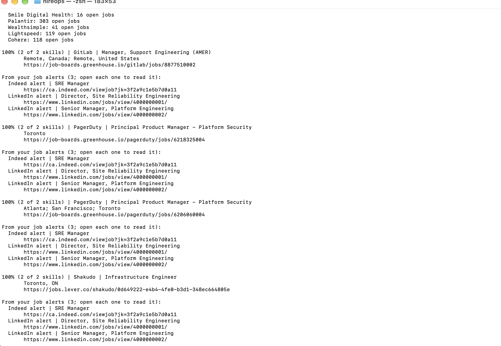

# HireOps


An SRE's toolkit for the job search: small, free, open-source tools that run on your own laptop. One new tool every week.

## Tool 1: JD Decoder (v0.1.0, prototype)

Give it a job description and your resume. It tells you:

- What the job really asks for: every skill it mentions (found by a local AI model, with no fixed keyword list), must-haves, nice-to-haves, seniority, years of experience, and red flags, each with the exact words from the posting that raise it
- Your match score: the share of the job's skills your resume mentions (calculated by plain rules, so it is repeatable and explainable)
- The skills the job asks for that your resume never mentions, and the resume lines that may show them in other words, for you to check
- Suggested resume bullets that use only what your resume already says
- Suggested edits to your resume for this job: lines to modify, keywords to add, lines to remove
- A warning whenever the AI adds a number that isn't in your resume
- Must-haves and nice-to-haves shown, a weighted score, and a list of real gaps (skills with no proof in your resume)
- How much each run cost: AI calls, tokens read and written, and seconds

### Example


### Getting started (one time)

You need a Mac or Linux computer (on Windows, use WSL) with Python 3.10 or newer and [Ollama](https://ollama.com/download). Install Ollama and open it once, then:

    git clone https://github.com/5hayam0hebbi/hireops.git
    cd hireops
    bash setup.sh

`setup.sh` checks Python and Ollama, downloads the llama3.2 model (about 2 GB, the first time only), creates a `.venv`, installs everything in `requirements.txt` and runs the tests. It's safe to run again.

### Every time

    source .venv/bin/activate
    python jd_decoder.py samples/job.txt --resume samples/resume.md

Options: `--no-ai` (rules only, fast), `--json` (machine-readable output), `-h` (help). `skills.json` is your backup skills list, used with `--no-ai` or when Ollama isn't running.

### How the score works

The local AI model reads the job and lists every skill it asks for. Plain rules then look for each of those skills in your resume as a whole word, in any letter case, including plurals and common aliases (for example "led a team" counts as Leadership). For a skill of several words, every key word must be on the same resume line. The score is the share of the job's skills that your resume mentions, so you can always see why.

Skills the word check misses go back to the AI, which points to the resume line that may show each one in other words. These matches are listed for you to check and never change the score, because a small model's judgment can be wrong. With `--no-ai`, the backup list in `skills.json` is used instead.

### What the AI does and doesn't do

- It reads the job description, finds its skills and red flags, and suggests resume bullets and edits. It runs locally through Ollama (llama3.2 by default; set `HIREOPS_MODEL` to try another model).
- It is told never to invent experience, and plain code checks its work:
  - a requirement is dropped if the posting never mentions it, and marked "not required" only if the posting says so
  - a red flag is dropped if its quote isn't in the posting or is standard HR or legal wording
  - each bullet must name the resume line it is based on and share real words with it; the code warns when a bullet invents a number, moves a number from another line, upgrades a claim ("fixed" to "automated"), or borrows words from the job that your resume never uses
- Every AI step has a time limit (`HIREOPS_TIMEOUT`, 180 seconds by default) and gets one retry, so a run never hangs.
- Every AI call is logged as one JSON line (`ai_usage`) with its tokens read, tokens written and seconds, in `hireops.log` locally and in Log Analytics on Azure.
- Nothing changes your resume file. Always read every suggestion before you use it.

### Privacy

Your resume and job files never leave your computer. The samples in this repo are fictional. Keep your real files in a `private/` folder, which `.gitignore` keeps out of Git.

### Tests

`pytest -v` runs 107 tests across all the tools with no AI needed (the AI's answers are faked). `test_real_jobs.py` holds regression tests from real job postings: each mistake HireOps made on a real job became a test, so it can't come back. GitHub Actions runs Ruff and the tests on every push.

### Limitations

- A small local model can be slow (each AI step takes about 10 to 60 seconds on a laptop) and sometimes gives weak bullets; run it again or try a bigger model.
- A skill written very differently in your resume can show as missing; check the "Possibly shown in other words" list.
- The command line takes the job posting as a text file; the web app also reads job links and uploaded resumes.

## Tool 2: Job Radar (v0.2.0)



Every weekday morning, Job Radar checks the public job boards of the companies you choose (Greenhouse, Lever and Ashby, no login needed), keeps only the roles that match your titles and places, scores each one against your resume with JD Decoder's rules, and shows only what's new since the last run. It also reads the LinkedIn and Indeed job-alert emails you save, so those roles land in the same list.

    python radar.py --resume private/resume.md

- Edit `radar_config.json`: your companies (`board` is `greenhouse`, `lever` or `ashby`; `slug` is the company's name in the board's web address), the titles and places you want, and words to exclude.
- `--all` shows every match, not only new ones.
- **Alert emails:** in Gmail, open a LinkedIn or Indeed job alert → ⋮ → **Download message**, and move the `.eml` file into `private/alerts/`. `--alerts <folder>` reads another folder (try `--alerts samples/alerts`). Alert jobs are checked by title only, because the email has no job text.
- Each run saves a Markdown digest in `digests/`. Your digests, `seen.json`, saved emails and resume stay on your computer (they're in `.gitignore`).
- **Runs by itself:** `.github/workflows/radar.yml` runs Job Radar on GitHub every weekday at 11:30 UTC with the fictional sample resume. Open **Actions → Job Radar daily** to read the digest, or click **Run workflow** to run it now.
- Banks on Workday career sites have no public API: use their own email job alerts. Job Radar never scrapes websites or LinkedIn, and it never applies for you.

## Tool 3: Job Scout (AI agent)

Job Scout is an AI agent on the local model. Give it a goal in plain English; it
chooses HireOps tools (list companies, find jobs, read a job, score it against your
resume, save it to a shortlist), runs them one at a time, and answers.

```bash
python agent.py "Find SRE or platform roles at Datadog and score the top 3"
```

Guardrails, enforced in code (the model can't skip them):
- Only the tools listed in `SPECS`; every argument is checked against a Pydantic schema
- One tool per turn, so the model can't use job IDs it hasn't seen yet
- At most 8 steps and 30,000 tokens per run
- Nothing is saved without your yes in the terminal
- The final answer is checked before it's accepted: a made-up score, a promised
  call that was never made, or a tool call typed as text is sent back to the model
  (at most twice), then flagged
- A job ID in the answer that no tool returned is flagged as invented
- Every tool call is logged as a JSON line in `hireops.log`

Quality:
- `test_agent.py`: 22 tests with a scripted fake model prove each guardrail, and
  `test_eval_agent.py` (5 tests) checks the eval itself (all run in CI)
- `eval_agent.py`: grades the real model on 7 goals in `evals/agent_cases.json`,
  counting only tool calls that worked and checking key facts in each answer, with a
  sample shortlist so results never depend on private data. llama3.2: 5 of 7, and
  every failure is caught, not hidden (in the latest run: claiming "roles you haven't
  saved" without checking the shortlist, and searching jobs for an off-topic question).
  Results are in `evals/`.

Built with an agentic workflow: `CLAUDE.md` gives coding agents the repo map and
rules (plan first, small changes with tests, a human reviews every diff).

## Web app

    streamlit run app.py

Opens HireOps in your browser. On the JD Decoder page, paste a job link (Greenhouse, Lever or Ashby) or the job text, upload your resume (PDF, Word or text), and click Decode. Everything runs on your own laptop.

## Run it in Docker

    docker compose up -d ollama
    docker compose exec ollama ollama pull llama3.2
    docker compose run --rm --build hireops samples/job.txt --resume samples/resume.md

Every push to main builds the image and publishes it to `ghcr.io/5hayam0hebbi/hireops`.

## Deploy to Azure with Terraform

`infra/` deploys the image to Azure Container Apps as an on-demand job (rules-only mode). See `infra/terraform.tfvars.example`, then `terraform init && terraform apply`. `terraform destroy` removes everything.